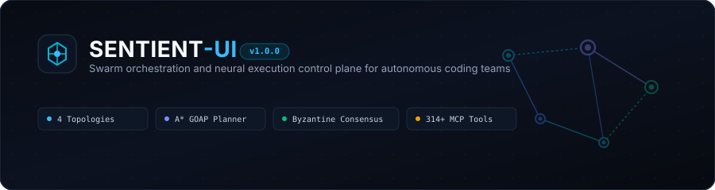
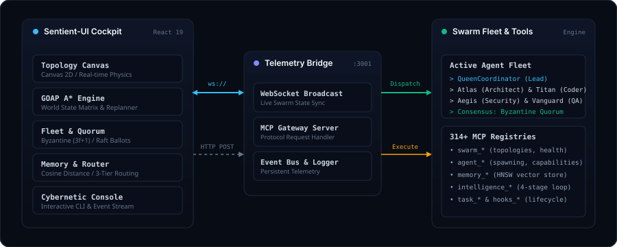

<div align="center">
  
</div>

<div align="center">

[](https://github.com/DeepxkJadhav/Sentient-UI/actions)
[](LICENSE)
[](https://www.typescriptlang.org/)
[](https://react.dev/)
[](https://vitejs.dev/)
[](https://github.com/DeepxkJadhav)

</div>

---

Sentient-UI is a visual swarm orchestrator and real-time execution control plane for autonomous coding agent fleets. It provides an interactive 2D canvas to observe physics-based agent topologies, an A* Goal-Oriented Action Planner (GOAP), Byzantine fault-tolerant consensus voting, a 314+ MCP tool explorer, and a 3-tier model router.

```
$ git clone https://github.com/DeepxkJadhav/Sentient-UI.git
$ cd Sentient-UI && npm install
$ npm run dev

  VITE v6.2.0  ready in 240 ms

  ➜  Local:   http://localhost:3000/
  ➜  Network: use --host to expose
  ➜  Bridge:  ws://localhost:3001/ws (6 agents connected, Byzantine quorum ready)
```

---

## Architecture

<div align="center">
  
</div>

The system operates across three coordinated tiers:
1. **Frontend Cockpit**: React 19 single-page application rendering an HTML5 Canvas 2D force-directed swarm graph at 60fps, GOAP task solver, consensus voting controls, vector memory inspector, and streaming event terminal.
2. **Telemetry Bridge**: Node.js and Express server running on port 3001 with a WebSocket server (`ws://localhost:3001/ws`) broadcasting agent heartbeats, log streams, and status deltas.
3. **Agent Fleet and MCP Engine**: Six pre-configured neural agent archetypes governed by Byzantine ($3f+1$) and Raft consensus, integrated with 314+ Model Context Protocol (MCP) tools.

---

## Core Systems

### 1. Swarm Topologies

Sentient-UI dynamically positions and routes communication across four graph layouts:

| Topology | Connectivity | Routing Characteristic | Primary Use Case |
|:---|:---|:---|:---|
| `mesh` | $O(N^2)$ all-to-all | Bi-directional peer messaging | Collaborative problem solving and cross-review |
| `hierarchical` | $O(N)$ tree | Lead-delegated task tree | Complex engineering pipelines with Queen dispatch |
| `centralized` | $O(N)$ radial star | Radial hub-and-spoke | High-throughput batch task distribution |
| `ring` | $O(N)$ circular | Sequential token handoff | Staged verification and assembly lines |

Switching topologies recalculates canvas physics springs in real time without restarting active agent processes.

### 2. Goal-Oriented Action Planning (GOAP)

The planner translates high-level prompts into minimal-cost execution plans using an A* graph search over an 8-bit world state bitmask:

```
World State Vector:
[ goalDefined | archValidated | codeGenerated | testsPassing | securityAudited | memoryIndexed | consensusReached | deployed ]
```

- **Preconditions and Effects**: Every registered action declares required bit inputs and positive/negative bit outputs.
- **Dynamic Replanning**: If an action encounters a compilation error or test failure during execution, the planner halts the pipeline, evaluates the mutated world state, and computes a new path to the goal.

### 3. Distributed Consensus Engine

Critical swarm operations require verification before state mutation. Four voting algorithms are implemented:

| Protocol | Quorum Requirement | Fault Tolerance | Typical Application |
|:---|:---|:---|:---|
| **Byzantine (BFT)** | $\ge 67\%$ supermajority | Survives $f$ Byzantine faults where $N \ge 3f + 1$ | Production deployments, architectural commits |
| **Raft** | $> 50\%$ majority | Survives minority node failure | Coordinator election, sequence log commit |
| **Paxos** | Weighted majority quorum | Distributed consensus | Cross-cluster state agreement |
| **Gossip** | Probabilistic convergence | Eventual consistency | Background vector cache synchronization |

### 4. 314+ MCP Tool Explorer

Sentient-UI includes an interactive inspector for Model Context Protocol (MCP) tool registrations across six namespaces:

- `swarm_*`: Swarm lifecycle initialization, topology transitions, and cluster health telemetry.
- `agent_*`: Dynamic agent spawning, role capabilities, and isolated memory allocation.
- `memory_*`: High-dimensional vector storage, cosine similarity queries, and cache sweeps.
- `intelligence_*`: 4-stage cognitive loop (`RETRIEVE` $\rightarrow$ `JUDGE` $\rightarrow$ `DISTILL` $\rightarrow$ `CONSOLIDATE`).
- `task_*`: Task creation, sub-task tree partitioning, assignment, and completion receipts.
- `hooks_*`: Pre-task invariants, post-task evaluations, and model routing hooks.

### 5. 3-Tier Model Router & Economics

Requests are dynamically classified across three execution tiers to balance latency and cost:

| Tier | Category | Engine | Latency | Cost / 1k Tokens |
|:---:|:---|:---|:---:|:---:|
| **Tier 1** | Deterministic | AST codemods, regex, local formatters | ~1ms | $0.000 |
| **Tier 2** | Reflex | Lightweight triage models (Flash / Haiku) | ~145ms | $0.001 |
| **Tier 3** | Reasoning | Multi-turn reasoning swarms (Sonnet / Pro / Opus) | ~890ms | $0.015 |

---

## Directory Structure

```
Sentient-UI/
├── assets/                            # Architecture diagrams and vector badges
│   ├── architecture.svg
│   └── hero.svg
├── .github/                           # CI/CD Workflows and repository templates
│   ├── workflows/                     # ci.yml, codeql.yml, release.yml
│   └── ISSUE_TEMPLATE/                # Bug report and feature request forms
├── server/
│   └── index.ts                       # Express HTTP server & WebSocket telemetry bridge
├── src/                               # Frontend single-page application
│   ├── components/                    # Canvas, GOAP solver, Fleet, Tool explorer, Terminal
│   ├── context/                       # Reactive swarm state & event bus
│   ├── data/                          # 314+ MCP tool catalog & agent archetypes
│   ├── lib/                           # A* solver, graph physics, and bitmask logic
│   └── types/                         # TypeScript interfaces (Swarm, GOAP, MCP, Memory)
├── plugins/                           # 48 Sentient monorepo packages
├── .agents/skills/                    # Specialized agent skill playbooks
├── package.json                       # Core dependencies, scripts, and monorepo configuration
├── vite.config.ts                     # Vite 6 bundler configuration
└── tailwind.config.js                 # Dark slate design system
```

---

## Getting Started

### Requirements
- **Node.js**: `20.x` or `22.x`
- **npm**: `9.x` or higher

### 1. Clone the repository
```bash
git clone https://github.com/DeepxkJadhav/Sentient-UI.git
cd Sentient-UI
```

### 2. Install dependencies
```bash
npm install
```

### 3. Launch the development environment
Start the frontend:
```bash
npm run dev
# Running at: http://localhost:3000
```

Start the backend telemetry server in a separate terminal:
```bash
npm run server
# HTTP API at: http://localhost:3001
# WebSocket stream at: ws://localhost:3001/ws
```

### 4. Build for production
```bash
npm run build
# Compiles TypeScript and bundles production assets into dist/
```

---

## WebSocket & Telemetry Protocol

The frontend connects to the backend over WebSocket at `ws://localhost:3001/ws`.

### Inbound Client Messages

Set topology:
```json
{
  "type": "SET_TOPOLOGY",
  "topology": "mesh"
}
```

Spawn an agent:
```json
{
  "type": "SPAWN_AGENT",
  "name": "Atlas-Security",
  "role": "Security Specialist",
  "capabilities": ["cve_scan", "auth_audit"]
}
```

### Outbound Server Broadcasts

Swarm log event:
```json
{
  "type": "LOG_ENTRY",
  "data": {
    "agent": "QueenCoordinator",
    "message": "Byzantine quorum reached with 83.3% approval",
    "level": "info",
    "timestamp": "2026-10-31T17:30:00.000Z"
  }
}
```

---

## Terminal Slash Commands

The embedded streaming cybernetic terminal provides live command-line interaction with the active swarm:

| Command | Arguments | Effect |
|:---|:---|:---|
| `/topology` | `mesh \| hierarchical \| star \| ring` | Triggers real-time canvas graph repositioning |
| `/spawn` | `<name> <role>` | Provisions a new agent into the active fleet |
| `/mission` | `<objective>` | Solves and executes an A* GOAP mission sequence |
| `/vote` | `<proposal_name>` | Initiates a Byzantine ($3f+1$) quorum vote |
| `/memory` | `<query>` | Executes cosine similarity search on the vector ledger |
| `/clear` | none | Flushes terminal scroll buffer |

---

## Contributing

Review [CONTRIBUTING.md](CONTRIBUTING.md) for branch naming conventions, TypeScript standards, and pull request verification checklists.

---

## Security

Vulnerabilities should be reported through [GitHub Security Advisories](https://github.com/DeepxkJadhav/Sentient-UI/security/advisories/new). See [SECURITY.md](SECURITY.md) for timeline commitments and safe harbor terms.

---

## License

This project is licensed under the [MIT License](LICENSE).  
Copyright (c) 2026 **[Deepxk Jadhav](https://github.com/DeepxkJadhav)**.
