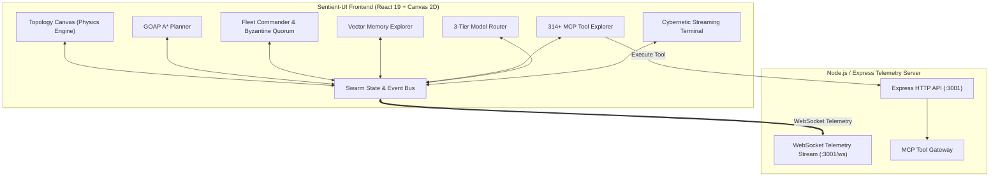

# Sentient-UI ⚡
### Autonomous Multi-Agent Swarm Orchestrator & Neural Mission Control Plane

<div align="center">

[](https://github.com/DeepxkJadhav/Sentient-UI/actions/workflows/ci.yml)
[](https://github.com/DeepxkJadhav/Sentient-UI)
[](https://github.com/DeepxkJadhav)
[](https://opensource.org/licenses/MIT)
[](https://react.dev/)
[](https://www.typescriptlang.org/)
[](https://vitejs.dev/)

**Sentient-UI** is a neural mission control plane and multi-agent swarm orchestrator designed for autonomous coding agents, visual topology coordination, Goal-Oriented Action Planning ($A^*$), and Byzantine fault-tolerant consensus.

[Quick Start](#-quick-start) • [Architecture](#-system-architecture) • [Features](#-core-capabilities) • [API & WebSocket](#-telemetry--websocket-api) • [Contributing](#-contributing)

</div>

---

## 🌟 Core Capabilities

### 1. 🌌 Interactive Swarm Topology Canvas
- **Dynamic Physics & Morphing**: Seamlessly transition between **Hierarchical**, **Mesh**, **Star**, and **Ring** topologies in real time.
- **Node Telemetry**: Live rendering of agent status (`idle`, `busy`, `thinking`, `error`), CPU load, memory utilization, and latency.
- **Visual Edge Pulses**: Animated particle packets flowing along active inter-agent communication channels.
- **Direct Delegation**: Inspect any agent node on the canvas to inspect its registered capabilities and inject direct task prompts.

### 2. 🧭 Goal-Oriented Action Planning (GOAP) A* Engine
- **Autonomous Mission Decomposition**: Converts natural-language objectives into an optimal $A^*$ shortest-path action sequence.
- **World State Bitmask Matrix**: Real-time evaluation of preconditions and post-condition effects (`goalDefined`, `architectureValidated`, `codeGenerated`, `testsPassing`, `securityAudited`, `memoryIndexed`, `consensusReached`, `deployed`).
- **Adaptive Dynamic Replanning**: Automatically recalculates path vectors from the current world state when environment obstacles occur.

### 3. 👑 Agent Fleet Commander & Byzantine Quorum
- **Specialized Archetypes**: Pre-configured agents including `QueenCoordinator`, `Atlas-Architect`, `Titan-Coder`, `Aegis-Security`, `Krypton-Reviewer`, and `Vanguard-Tester`.
- **Dynamic Spawning**: Provision custom neural workers with isolated working memory and distinct skill sets.
- **Distributed Consensus Engine**: Launch Byzantine ($3f+1$), Raft, Gossip, or Paxos voting ballots with live quorum progress meters.

### 4. 🔌 314+ MCP Tool Explorer & Gateway
- **Namespace Directory**: `swarm_*`, `agent_*`, `memory_*`, `intelligence_*`, `task_*`, and `hooks_*`.
- **Interactive JSON Playground**: Test tool executions with schema validation and real-time execution timing.

### 5. 🧠 Semantic Memory & Intelligence Pipeline
- **Vector Search**: High-dimensional cosine distance queries across semantic facts, ADRs, and reflexions.
- **4-Stage Cognitive Loop**: Visual execution of the intelligence cycle:
  $$\text{RETRIEVE} \longrightarrow \text{JUDGE} \longrightarrow \text{DISTILL} \longrightarrow \text{CONSOLIDATE}$$

### 6. ⚡ 3-Tier Model Router & Token Telemetry
- **Tier 1 (Deterministic)**: AST / Codemods ($0.00 / 0 tokens, 1ms).
- **Tier 2 (Reflex)**: Lightweight triage models (Flash / Haiku, 145ms).
- **Tier 3 (Frontier Reasoning)**: Multi-turn deep thinking swarms (Sonnet / Opus / Pro, 890ms).
- **Telemetry**: Real-time token burn rates, session cost tracking, and request distribution.

### 7. 💻 Live Swarm Event Bus & Streaming Terminal
- Real-time logging of all inter-agent messages, tool dispatches, and consensus ballots.
- Interactive CLI command bar supporting `/topology`, `/spawn`, `/mission`, `/vote`, and `/memory`.

---

## 🏛️ System Architecture



---

## 📂 Repository Structure

```
Sentient-UI/
├── .github/                           # CI/CD Workflows, CodeQL, Issue & PR templates
│   ├── workflows/                     # ci.yml, codeql.yml, release.yml
│   └── ISSUE_TEMPLATE/                # Interactive issue templates
├── server/
│   └── index.ts                       # Express + WebSocket telemetry & MCP bridge
├── src/                               # Sentient-UI React 19 / Canvas frontend
│   ├── components/                    # Canvas graph, GOAP tree, Fleet, MCP playground
│   ├── context/                       # Swarm state, event stream, and consensus bus
│   ├── lib/                           # GOAP A* solver & state transitions
│   ├── types/                         # Swarm, GOAP, Memory, and MCP type definitions
│   └── data/                          # Tool definitions & agent presets
├── plugins/                           # Monorepo plugins & specialized extensions
├── .agents/skills/                    # Specialized agent skill playbooks
├── package.json                       # Core dependencies, scripts, and workspaces
├── vite.config.ts                     # Vite 6 configuration & proxy routing
├── tailwind.config.js                 # Cybernetic dark design system
├── LICENSE                            # MIT License (Deepxk Jadhav)
├── CONTRIBUTING.md                    # Contribution guidelines
├── SECURITY.md                        # Security policy
└── CHANGELOG.md                       # Release notes and history
```

---

## 🚀 Quick Start

### Prerequisites
- **Node.js**: >= 20.0.0
- **npm**: >= 9.0.0

### 1. Clone & Install
```bash
git clone https://github.com/DeepxkJadhav/Sentient-UI.git
cd Sentient-UI
npm install
```

### 2. Start the Frontend
```bash
npm run dev
# Running at: http://localhost:3000
```

### 3. Start the Telemetry & WebSocket Server
```bash
npm run server
# HTTP API at: http://localhost:3001
# WebSocket stream at: ws://localhost:3001/ws
```

### 4. Build for Production
```bash
npm run build
# Compiles TypeScript and creates optimized bundle in /dist
```

---

## 📡 Telemetry & WebSocket API

Sentient-UI communicates with local or distributed agents through WebSocket streams:

### Connection
- **Endpoint**: `ws://localhost:3001/ws`

### Client Commands (JSON Payload)
```json
{
  "type": "SET_TOPOLOGY",
  "topology": "mesh"
}
```

```json
{
  "type": "SPAWN_AGENT",
  "name": "Sentinel-1",
  "role": "Security Specialist",
  "capabilities": ["audit", "cve_scan"]
}
```

### Server Events
```json
{
  "type": "LOG_ENTRY",
  "data": {
    "agent": "QueenCoordinator",
    "message": "Swarm converged on Byzantine quorum",
    "level": "info",
    "timestamp": "2026-10-31T03:30:00.000Z"
  }
}
```

---

## 💻 Terminal Commands

The embedded streaming cybernetic terminal provides real-time CLI commands:

| Command | Arguments | Description |
|---------|-----------|-------------|
| `/topology` | `<mesh\|hierarchical\|star\|ring>` | Instantly morphs the swarm canvas topology |
| `/spawn` | `<name> <role>` | Provisions and initializes a new agent in the active fleet |
| `/mission` | `<objective description>` | Formulates and runs an $A^*$ GOAP mission plan |
| `/vote` | `<proposal_name>` | Triggers a Byzantine ($3f+1$) consensus vote |
| `/memory` | `<search query>` | Executes high-dimensional vector memory retrieval |
| `/clear` | - | Clears the terminal screen |

---

## 🤝 Contributing

Contributions are welcomed! Please see [CONTRIBUTING.md](CONTRIBUTING.md) for details on code style, branch conventions, and testing requirements.

---

## 🛡️ Security

For vulnerability disclosure and security procedures, see [SECURITY.md](SECURITY.md).

---

## 📜 License

This project is licensed under the MIT License — see the [LICENSE](LICENSE) file for details.  
Copyright (c) 2026 **[Deepxk Jadhav](https://github.com/DeepxkJadhav)**.
