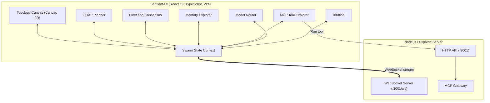

# Sentient-UI

Visual swarm orchestrator and control plane for AI agent teams.

[](https://github.com/DeepxkJadhav/Sentient-UI/actions/workflows/ci.yml)
[](https://github.com/DeepxkJadhav/Sentient-UI)
[](https://github.com/DeepxkJadhav)
[](https://opensource.org/licenses/MIT)

Sentient-UI is a web dashboard and execution layer for running coordinated teams of coding agents. It provides an interactive canvas to view agent topologies, a goal-oriented action planner (GOAP) based on A* search, consensus voting mechanisms, and an inspector for Model Context Protocol (MCP) tools.

---

## Features

### Topology canvas
- Renders agents as nodes with live status indicators (idle, busy, thinking, error).
- Supports four topologies: mesh, hierarchical, star, and ring.
- Animates message passing along connection lines.
- Lets you select any agent to view its properties and send instructions directly.

### Goal planner (GOAP)
- Breaks down high-level objectives into sequential steps using A* search.
- Tracks world state across preconditions and postconditions (architecture, code generation, test runs, security reviews, and deployments).
- Re-plans automatically if an intermediate step fails.

### Fleet management and consensus
- Includes predefined agent archetypes: coordinator, architect, coder, reviewer, security, and tester.
- Spawns custom agents with dedicated roles and capabilities.
- Implements four voting protocols: Byzantine fault tolerance (3f+1), Raft, Paxos, and Gossip.

### MCP tool explorer
- Lists 314+ Model Context Protocol tools grouped by namespace (`swarm_*`, `agent_*`, `memory_*`, `intelligence_*`, `task_*`, `hooks_*`).
- Displays parameter schemas and input fields.
- Allows running tool calls with real-time latency measurement.

### Vector memory
- Queries embeddings using cosine distance to retrieve architectural records and previous task logs.
- Displays the cognitive loop cycle: retrieve, judge, distill, and consolidate.

### Model router
- Shows request distribution across three tiers:
  - Tier 1: Deterministic codemods and AST tools (zero token cost, ~1ms).
  - Tier 2: Fast triage models (~145ms).
  - Tier 3: Reasoning models for complex multi-turn plans (~890ms).
- Reports token consumption, latency averages, and estimated cost.

### Event terminal
- Displays real-time logs from agent communication and tool execution.
- Includes a command bar supporting `/topology`, `/spawn`, `/mission`, `/vote`, `/memory`, and `/clear`.

---

## Architecture



---

## Repository layout

```
Sentient-UI/
├── .github/                           # CI workflows and issue templates
├── server/
│   └── index.ts                       # Express and WebSocket server
├── src/                               # Frontend source
│   ├── components/                    # Canvas, GOAP, Fleet, and Tool explorer
│   ├── context/                       # Swarm state and event stream
│   ├── lib/                           # GOAP solver and graph physics
│   ├── types/                         # TypeScript interfaces
│   └── data/                          # Tool definitions and default agents
├── plugins/                           # Monorepo plugins
├── .agents/skills/                    # Skill playbooks
├── package.json                       # Scripts and dependencies
├── vite.config.ts                     # Vite build configuration
└── tailwind.config.js                 # Styling configuration
```

---

## Quick start

### Prerequisites
- Node.js 20 or higher
- npm 9 or higher

### 1. Install
```bash
git clone https://github.com/DeepxkJadhav/Sentient-UI.git
cd Sentient-UI
npm install
```

### 2. Start the frontend
```bash
npm run dev
```
Open `http://localhost:3000` in your browser.

### 3. Start the backend
In a separate terminal:
```bash
npm run server
```
The HTTP server runs on `http://localhost:3001` and the WebSocket stream listens on `ws://localhost:3001/ws`.

### 4. Build for production
```bash
npm run build
```
This runs `tsc` and generates static assets in `dist/`.

---

## Telemetry and WebSocket API

The frontend connects to the backend at `ws://localhost:3001/ws`.

### Client messages
Change topology:
```json
{
  "type": "SET_TOPOLOGY",
  "topology": "mesh"
}
```

Spawn an agent:
```json
{
  "type": "SPAWN_AGENT",
  "name": "Tester-2",
  "role": "Integration Tester",
  "capabilities": ["vitest", "e2e"]
}
```

### Server messages
Event log broadcast:
```json
{
  "type": "LOG_ENTRY",
  "data": {
    "agent": "QueenCoordinator",
    "message": "Quorum accepted for deployment",
    "level": "info",
    "timestamp": "2026-10-31T03:30:00.000Z"
  }
}
```

---

## Terminal commands

The terminal at the bottom of the interface accepts the following slash commands:

| Command | Arguments | Description |
|---------|-----------|-------------|
| `/topology` | `mesh`, `hierarchical`, `star`, or `ring` | Changes the canvas topology layout |
| `/spawn` | `<name> <role>` | Adds a new agent to the active fleet |
| `/mission` | `<objective>` | Solves and executes an A* GOAP plan |
| `/vote` | `<proposal>` | Starts a consensus vote across active agents |
| `/memory` | `<query>` | Searches the memory store by cosine distance |
| `/clear` | none | Clears terminal history |

---

## Contributing

See [CONTRIBUTING.md](CONTRIBUTING.md) for contribution guidelines, branch conventions, and testing instructions.

---

## Security

Please report vulnerabilities privately following the process in [SECURITY.md](SECURITY.md).

---

## License

MIT License. Copyright (c) 2026 Deepxk Jadhav.
